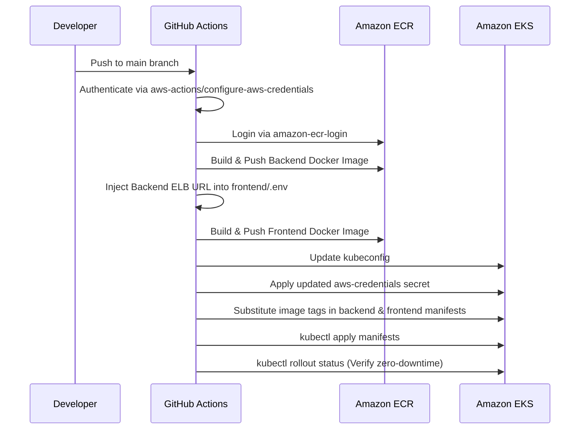

# 📘 S.V.O.R.A — Comprehensive Project Details & Technical Specifications

This document provides an exhaustive, component-by-component architectural guide to the **S.V.O.R.A** (*Smart Vehicle Operational Reliability & Analytics*) Aircraft Maintenance Intelligence Platform.

---

## 📑 Table of Contents
1. [Platform Overview & Objectives](#1-platform-overview--objectives)
2. [Complete Technology Stack](#2-complete-technology-stack)
3. [Frontend Architecture & Component Breakdown](#3-frontend-architecture--component-breakdown)
4. [Backend Architecture & Data Processing Modules](#4-backend-architecture--data-processing-modules)
5. [Amazon Bedrock & Generative AI Grounding](#5-amazon-bedrock--generative-ai-grounding)
6. [API Specifications & Data Contracts](#6-api-specifications--data-contracts)
7. [Containerization & Docker Architecture](#7-containerization--docker-architecture)
8. [AWS Cloud & Kubernetes (EKS) Infrastructure](#8-aws-cloud--kubernetes-eks-infrastructure)
9. [CI/CD Pipeline (GitHub Actions)](#9-cicd-pipeline-github-actions)
10. [AeroTech ATX-200 Aviation Domain Knowledge](#10-aerotech-atx-200-aviation-domain-knowledge)

---

## 1. Platform Overview & Objectives

**S.V.O.R.A** bridges the gap between raw flight telemetry and real-world aviation maintenance operations.

### Key Objectives
- **Automated Telemetry Ingestion**: Ingest raw multi-cycle flight logs (`.xlsx`) recorded across multiple aircraft tails (`AIR-001` through `AIR-005`).
- **Baseline Statistical Analysis**: Compare current post-landing readings against a rolling 10-flight baseline to detect drift, vibration creep, or thermal degradation before catastrophic failures occur.
- **Manual-Grounded Generative AI**: Pass sensor statistics directly into **Amazon Bedrock (Nova Pro)** alongside the official **AeroTech ATX-200 Turbofan Engine Maintenance & Inspection Manual** to produce authoritative, hallucination-free maintenance recommendations.
- **Actionable Flight Readiness**: Provide airline operations centers with instant, unequivocal flight-status decisions (`CLEARED_TO_FLY`, `FLY_WITH_MONITORING`, `MAINTENANCE_REQUIRED_BEFORE_FLIGHT`, `GROUND_AIRCRAFT`) and one-click printable work orders.

---

## 2. Complete Technology Stack

### Frontend
- **Framework**: React 18.3.1 (Functional Components, Hooks)
- **Build Tool**: Vite 5.4.10 (ESModules, sub-second HMR)
- **Styling**: Pure CSS3 Design System with CSS Custom Properties (Dark aviation theme, glassmorphism, responsive CSS Grid / Flexbox)
- **Web Server (Production)**: Nginx Alpine (Custom SPA fallback routing, Gzip compression, $< 10\text{ MB}$ memory footprint)

### Backend
- **Language**: Python 3.12 (Strict typing, dataclasses, asynchronous endpoints)
- **Web Framework**: FastAPI 0.115.0
- **ASGI Server**: Uvicorn 0.30.0 / 0.54.0
- **Data Analytics Engine**: Pandas 2.2+ / 3.0+, OpenPyXL 3.1.5, NumPy
- **Cloud & AI SDK**: Boto3 1.34+ (Amazon Bedrock Runtime client)
- **Environment Management**: Python-Dotenv 1.0.0
- **Multipart Form Parser**: Python-Multipart 0.0.9+
- **Packaging & Dependency Tool**: Astral `uv` (Fast Rust-based package installer)

### Cloud Infrastructure (AWS ap-southeast-2)
- **Container Registry**: Amazon Elastic Container Registry (Amazon ECR)
  - `644272928959.dkr.ecr.ap-southeast-2.amazonaws.com/backend-api-maintenance`
  - `644272928959.dkr.ecr.ap-southeast-2.amazonaws.com/maintenance-frontend`
- **Orchestration**: Amazon Elastic Kubernetes Service (Amazon EKS)
  - Cluster Name: `SVORA-AI_AIRCRAFT_MANAGEMENT`
  - Compute: Managed EC2 Node Group (`t3.small` instance)
  - Networking: AWS VPC CNI with optimized pod slot allocation
- **Load Balancing**: AWS Classic Load Balancers (ELB)
  - Frontend Load Balancer: Port 80 (Public HTTP)
  - Backend Load Balancer: Port 80 -> Container Port 8000
- **Identity & Security**: AWS IAM, Kubernetes Secrets (`aws-credentials`)

### Generative AI
- **Foundation Model**: `amazon.nova-pro-v1:0` (hosted in `us-east-1`)
- **API Mechanism**: Amazon Bedrock Converse API with native PDF document byte streaming
- **Inference Configuration**: Temperature `0.2`, Max Tokens `2000`

---

## 3. Frontend Architecture & Component Breakdown

The frontend (`frontend/`) is engineered as a responsive Single Page Application (SPA).

```text
frontend/src/
├── main.jsx                     # React DOM root render
├── App.jsx                      # Primary application layout & orchestration
├── styles.css                   # Global styles, variables, keyframes & responsive grid
├── api/
│   └── client.js                # Fetch abstraction, error wrapping & dynamic URL resolution
└── components/
    └── PanelCard.jsx            # Reusable card component with optional badges & accents
```

### Components in Detail

#### 1. `App.jsx` (Core Dashboard)
- **State Management**:
  - `excelFile`: Selected/dragged `.xlsx` telemetry file.
  - `status`: Live connectivity indicator pinging `GET /` or `GET /testing/health`.
  - `isLoading` & `loadingPhase`: Dual-state loading indicators (`analytics` vs `ai`).
  - `analyticsResult`: Holds Stage 1 JSON output from the backend.
  - `recommendation`: Holds Stage 2 AI diagnosis and work order output.
  - `checkedSteps`: Set storing toggled inspection checklist items.
  - `dragOver`: Boolean managing visual drop-zone states.
- **Workflow Strip**: Displays the 3-step operational progression:
  1. *Flight Intake*: Upload landed-flight telemetry.
  2. *Condition Review*: Compare signals with historical baselines.
  3. *Action Guidance*: Receive AI-backed maintenance decisions.
- **Animated SVG Flight Track Visualizer**:
  - An inline vector graphic rendering an aircraft on a cubic Bézier flight path (`M24 82 C70 20...`) across departure, en-route, and landing nodes.
  - Features animated fuselage, wings, tail fin, windows, and engine exhaust glow.

#### 2. `PanelCard.jsx`
- Reusable glassmorphic panel container.
- Props: `title`, `subtitle`, `badge`, `accent` (e.g., `ai` accent with subtle blue/purple neon border), and `children`.

#### 3. `AiLoadingSteps`
- Staged visual loader simulating engineering diagnosis phases:
  - Step 1: *Reading telemetry data* (0ms)
  - Step 2: *Consulting maintenance manual* (2500ms)
  - Step 3: *Generating maintenance decision* (5000ms)

#### 4. Engine Gauges Grid
- Visual gauge bars for 8 critical propulsion metrics:
  - `Engine Temperature` (max: 900°C, warn: 750°C)
  - `Exhaust Gas Temperature (EGT)` (max: 850°C, warn: 700°C)
  - `Oil Temperature` (max: 150°C, warn: 110°C)
  - `Oil Pressure` (max: 65 PSI, warn: 45 PSI)
  - `Engine RPM` (max: 12000 RPM, warn: 10500 RPM)
  - `Fuel Flow` (max: 3200 kg/h, warn: 2800 kg/h)
  - `Compressor Pressure` (max: 55 PSI, warn: 48 PSI)
  - `Hydraulic Pressure` (max: 3500 PSI, warn: 3200 PSI)
- Dynamic fill colors: Green (`level-ok`), Yellow (`level-warn`), Red (`level-danger`).

#### 5. Signal Trends Table
- Interactive table summarizing all 14 parameters:
  - Columns: `Parameter`, `Current`, `Avg`, `Std Dev`, `Change`, `Trend Direction`.
  - Trend badges with directional arrows: `INCREASING (↑)`, `DECREASING (↓)`, `STABLE (→)`.

#### 6. Flight Decision Banner
- Prominent operational status block showing the final readiness verdict:
  - Color-coded: `fly-cleared` (green), `fly-monitor` (cyan), `fly-maint` (amber), `fly-ground` (red).
  - Contains `can_fly_now` pill, UI statement, pre-flight requirements, and engineering rationale.

#### 7. Work Order Card & Exporter
- Formatted work order (`WO-<AIRCRAFT_ID>-C<CYCLE>`).
- Buttons:
  - **🖨️ Print Work Order**: Triggers native `window.print()` with print-optimized CSS.
  - **⬇️ Export JSON**: Formats work order tasks and tool requirements into an exported JSON blob.

#### 8. API Client (`frontend/src/api/client.js`)
- Resolves `VITE_API_BASE_URL` dynamically with fallback to the live AWS Load Balancer.
- Methods:
  - `healthCheck()`: Tests `/` and `/testing/health`.
  - `uploadAnalyticsFile(file)`: Sends FormData to `/aircraft/analytics`.
  - `getMaintenanceRecommendation(payload)`: Sends JSON to `/aircraft/maintenance-prediction`.

---

## 4. Backend Architecture & Data Processing Modules

The backend (`backend/`) is a Python application structured into deterministic data analytics and LLM orchestration.

```text
backend/
├── app.py                                            # FastAPI server & route handlers
├── pyproject.toml & requirements.txt                 # Dependencies
├── dockerfile                                        # Container configuration
└── src/
    └── aircraft_maintenance/
        ├── engineering_analytics.py                  # Stage 1 analytics
        └── bedrock_maintenance_analyzer.py           # Stage 2 Bedrock & rule engine
```

### 1. `app.py`
- Pre-configures `sys.path` so packages inside `src` resolve seamlessly.
- Configures permissive, standards-compliant CORS allowing all web origins without credential wildcard conflicts.
- Implements resilient error handling for missing files, invalid spreadsheet schemas, and network interruptions.

### 2. `engineering_analytics.py` (Stage 1)
- **Header Cleaning & Alias Normalization**:
  - Automatically strips units such as `(PSI)`, `(°C)`, `(cycles)`, `(kg/h)`.
  - Converts aliases: `tailnumber`, `tailno`, `aircraft` $\rightarrow$ `Aircraft_ID`; `flightnumber`, `cycle` $\rightarrow$ `Flight_Cycle`.
- **Validation**: Requires `Aircraft_ID` and `Flight_Cycle` columns.
- **Windowed Baseline Math**:
  - Identifies the latest flight record.
  - Selects the previous $N$ records (default $N = 10$).
  - For each numeric column, computes:
    $$\text{Average} = \mu = \frac{1}{N}\sum_{i=1}^N x_i$$
    $$\text{Standard Deviation} = \sigma = \sqrt{\frac{1}{N}\sum_{i=1}^N (x_i - \mu)^2}$$
    $$\Delta = x_{\text{latest}} - \mu$$
    $$\%\text{ Change} = \frac{\Delta}{\mu} \times 100$$
  - Trend classification: `INCREASING` if $\%\text{ Change} > +3\%$, `DECREASING` if $< -3\%$, else `STABLE`.
- **Decision Stripping**: Removes pre-existing decision columns (`Detected_Failure_Mode`, `Recommended_Maintenance_Action`, `Maintenance_Status`) from `current_record` so the downstream AI is unbiased.
- **Serialization Safety**: Converts NumPy types (`int64`, `float64`) and NaNs into standard Python primitives for clean JSON encoding.

### 3. `bedrock_maintenance_analyzer.py` (Stage 2)
- Encapsulates Bedrock Converse communication and fallback logic.
- Document name sanitizer: Sanitizes the PDF document name to strictly match `^[a-zA-Z0-9_.-]+$` required by AWS Bedrock.
- Markdown fence stripper: Handles model responses whether wrapped in ````json ... ```` or returned bare.
- **Deterministic ATX-200 Rule Engine**:
  - Evaluates telemetry directly against Chapter 3 operating thresholds, Chapter 5 failure modes, Chapter 7 troubleshooting trees, and Chapter 8 risk matrix.
  - Automatically activates if AWS credentials are unset, if `MOCK_BEDROCK=true`, or if AWS Bedrock returns a `ThrottlingException` (e.g., daily token quotas).

---

## 5. Amazon Bedrock & Generative AI Grounding

### Prompt Engineering Strategy
The analyzer constructs a comprehensive prompt assigning the LLM the persona of a **Senior Aircraft Maintenance Engineer**:
1. **Mandatory Grounding**: Every parameter must be evaluated against the attached AeroTech ATX-200 manual.
2. **Zero Hallucination**: The model is prohibited from inventing thresholds, tolerances, or part numbers not documented in the manual.
3. **Structured Output**: Enforces strict JSON adherence without conversational preambles or markdown wrappers.

### Multimodal Document Payload (Converse API)
```python
conversation = [
    {
        "role": "user",
        "content": [
            {"text": prompt_with_engineering_json},
            {
                "document": {
                    "format": "pdf",
                    "name": "AeroTech_ATX200_Maintenance_Manual",
                    "source": {"bytes": pdf_bytes},
                }
            },
        ],
    }
]
```

---

## 6. API Specifications & Data Contracts

### Endpoint 1: `GET /`
- **Purpose**: Root health check.
- **Response**:
```json
{
  "status": "ok",
  "service": "aircraft-maintenance-api",
  "message": "S.V.O.R.A Backend is running"
}
```

### Endpoint 2: `GET /testing/health`
- **Purpose**: Kubernetes liveness/readiness probe.
- **Response**: `{"status": "ok", "service": "aircraft-maintenance-api"}`

### Endpoint 3: `GET /aircraft/sample`
- **Purpose**: Queries availability of bundled sample telemetry.
- **Response**: `{"available": true, "filename": "...", "aircraft_ids": ["AIR-001", "AIR-002", ...]}`

### Endpoint 4: `POST /aircraft/analytics`
- **Content-Type**: `multipart/form-data`
- **Parameters**: `excel_file` (File), `aircraft_id` (Optional Form string)
- **Response Structure**:
```json
{
  "message": "Analytics generated successfully",
  "aircraft_id": "AIR-001",
  "available_aircraft": ["AIR-001", "AIR-002", "AIR-003", "AIR-004", "AIR-005"],
  "summary": {
    "aircraft_id": "AIR-001",
    "latest_flight_cycle": 101,
    "current_record": {
      "Aircraft_ID": "AIR-001",
      "Aircraft_Model": "A320neo",
      "Engine_Model": "CFM LEAP-1A",
      "Airport_Code": "DEL",
      "Flight_Cycle": 101,
      "Flight_Hours": 390.0,
      "Cycles_Since_Overhaul": 101,
      "Last_Maintenance_Date": "2026-10-28",
      "Ambient_Temperature": 30.0,
      "Humidity": 150.0,
      "Outside_Air_Temperature": 36.0,
      "Engine_Temperature": 1500.0,
      "Exhaust_Gas_Temperature": 1000.0,
      "Oil_Temperature": 250.0,
      "Oil_Pressure": 100.0,
      "Engine_Vibration": 15.0,
      "Compressor_Pressure": 44.6,
      "Fuel_Flow": 2456.8,
      "Hydraulic_Pressure": 5000.0,
      "Engine_RPM": 9796,
      "Risk_Score": 98.0,
      "Remaining_Useful_Life": 30
    },
    "historical_window_size": 10,
    "historical_analysis": [
      {
        "column": "Engine_Vibration",
        "latest_value": 15.0,
        "historical_average": 5.756,
        "historical_median": 5.75,
        "historical_std_dev": 0.189,
        "change_from_average": 9.244,
        "change_percent": 160.598,
        "trend_direction": "INCREASING"
      }
    ]
  }
}
```

### Endpoint 5: `POST /aircraft/maintenance-prediction`
- **Content-Type**: `application/json`
- **Input**: The full JSON object returned by `/aircraft/analytics`.
- **Response Structure**:
```json
{
  "success": true,
  "mode": "bedrock | manual_grounded_fallback",
  "report": {
    "aircraft": "AIR-001",
    "aircraft_model": "A320neo",
    "health_status": "GROUND AIRCRAFT",
    "risk_level": "CRITICAL",
    "safe_for_next_flight": false,
    "final_flight_decision": {
      "decision": "GROUND_AIRCRAFT",
      "can_fly_now": false,
      "ui_statement": "AIRCRAFT GROUNDED — Critical parameter violations detected.",
      "required_before_next_flight": "Complete mandatory Chapter 6 inspections.",
      "decision_rationale": "Safety-critical parameters exceed limits defined in Chapter 3."
    },
    "overall_summary": "Engineering assessment for aircraft AIR-001...",
    "threshold_violations": [
      {
        "parameter": "Engine_Vibration",
        "observed_value": 15.0,
        "manual_threshold": "> 4.7 mm/s (Critical)",
        "severity": "CRITICAL",
        "manual_reference": "Table 3.1 & Chapter 6.5",
        "explanation": "Engine vibration is in the Critical range."
      }
    ],
    "root_cause": {
      "most_likely_cause": "Severe Bearing Wear and Thermal Overload (Section 5.1.1)",
      "supporting_evidence": ["Vibration sustained at 15.0 mm/s..."],
      "manual_reference": "ATX-200 Manual Section 5.1.1"
    },
    "maintenance_actions": [
      {
        "priority": 1,
        "action": "Perform Bearing Inspection and Oil Debris Analysis",
        "reason": "Vibration exceedance triggers mandatory bearing check",
        "manual_reference": "Chapter 6.5"
      }
    ],
    "inspection_checklist": [
      {
        "step": 1,
        "inspection_item": "Post-Flight Walkaround & Visual Leak Inspection",
        "acceptance_criteria": "No fluid stains, chafing, or foreign object damage",
        "manual_reference": "Chapter 6.1"
      }
    ],
    "work_order": {
      "title": "Work Order WO-AIR-001-C101",
      "aircraft_id": "AIR-001",
      "work_order_type": "GROUNDING",
      "priority": "CRITICAL",
      "tasks": ["Perform Bearing Inspection..."],
      "required_parts_or_tools": ["Optical Borescope Kit (ATX-BK100)"],
      "estimated_maintenance_category": "Unscheduled Maintenance / Condition-Based"
    },
    "confidence": {
      "score": 0.95,
      "rationale": "High confidence based on direct cross-referencing.",
      "missing_information": []
    }
  }
}
```

---

## 7. Containerization & Docker Architecture

### Backend Dockerfile (`backend/dockerfile`)
- **Base Image**: `python:3.12-slim`
- **Installer**: `uv` installed via pip for sub-second package resolution.
- **Layer Caching**: `requirements.txt` is copied and installed prior to copying source code.
- **Security Sandboxing**: Runs as an unprivileged user `appuser` (UID 1000).
- **Healthcheck**: Uses Python standard library `urllib` to test `/testing/health` every 30s.
- **Command**: `["uvicorn", "app:app", "--host", "0.0.0.0", "--port", "8000"]`

### Frontend Dockerfile (`frontend/dockerfile`)
- **Stage 1 (Builder)**: `node:20-alpine` runs `npm ci && npm run build`.
- **Stage 2 (Runtime)**: `nginx:alpine`
  - Injects custom `/etc/nginx/conf.d/default.conf` with `try_files $uri $uri/ /index.html;` for client-side SPA routing.
  - Memory consumption is $< 10\text{ MB}$, preventing memory crashes on small cloud nodes.
- **Healthcheck**: Queries `http://localhost:80/` via `wget`.
- **Port**: Listens on port `80`.

---

## 8. AWS Cloud & Kubernetes (EKS) Infrastructure

The live system is deployed to **Amazon Elastic Kubernetes Service (Amazon EKS)**.

### Cluster Details
- **Cluster**: `SVORA-AI_AIRCRAFT_MANAGEMENT`
- **Region**: `ap-southeast-2` (Sydney)
- **Node**: EC2 `t3.small` (2 vCPU, 2GB RAM)

### ENI & Pod Slot Optimization
- On AWS EKS, EC2 `t3.small` nodes are constrained by AWS VPC CNI to a hardware maximum of **11 IP addresses / pods**.
- Redundant monitoring daemonsets (`amazon-cloudwatch-observability`) and duplicate replicas (`coredns` x2, `metrics-server` x2) were right-sized to free up dedicated slots for the application workloads.

### Kubernetes Manifests (`kubernetes/`)
1. **`backend-deployment.yaml`**:
   - Deployment: `backend-api-maintenance`
   - Replicas: 1
   - Pod port: 8000
   - Injects `aws-credentials` secret
   - Requests: 100m CPU / 128Mi RAM; Limits: 500m CPU / 512Mi RAM
2. **`backend-service.yaml`**:
   - Service: `backend-api-maintenance`
   - Type: `LoadBalancer`
   - Port 80 $\rightarrow$ TargetPort 8000
3. **`frontend-deployment.yaml`**:
   - Deployment: `frontend-maintenance`
   - Replicas: 1
   - Pod port: 80
   - Requests: 50m CPU / 64Mi RAM; Limits: 200m CPU / 256Mi RAM
4. **`frontend-service.yaml`**:
   - Service: `frontend-maintenance`
   - Type: `LoadBalancer`
   - Port 80 $\rightarrow$ TargetPort 80
5. **`aws-secrets.yml`**:
   - Kubernetes Secret: `aws-credentials`
   - Keys: `AWS_ACCESS_KEY_ID`, `AWS_SECRET_ACCESS_KEY`, `AWS_REGION`

---

## 9. CI/CD Pipeline (GitHub Actions)

Located in [`.github/workflows/deploy.yml`](.github/workflows/deploy.yml):



---

## 10. AeroTech ATX-200 Aviation Domain Knowledge

The platform is strictly calibrated against the *AeroTech AT-320 Aircraft / ATX-200 Turbofan Engine Maintenance & Inspection Manual (Rev 1.0)*:

### Monitored Parameters & Operational Bands (Table 3.1)
| Parameter | Normal Range | Warning Band | Critical Limit | Recommended Action |
| :--- | :--- | :--- | :--- | :--- |
| **Engine Temperature** | 640 – 676 °C | 676 – 696 °C | > 696 °C | Inspect cooling air ducts and combustion liner |
| **Exhaust Gas Temp (EGT)** | 615 – 648 °C | 648 – 668 °C | > 668 °C | Inspect turbine section; review fuel scheduling |
| **Oil Temperature** | 82 – 92 °C | 92 – 95 °C | > 95 °C | Inspect oil cooler and scavenge lines |
| **Oil Pressure** | 55 – 61 PSI | 52 – 55 PSI | < 52 PSI | Inspect oil pump, filter, and seals |
| **Engine Vibration** | 0 – 3.1 mm/s | 3.1 – 4.7 mm/s | > 4.7 mm/s | Inspect bearing assembly and rotating components |
| **Compressor Pressure** | 38.5 – 41.5 PSI | 41.5 – 42.7 PSI | > 42.7 PSI | Inspect variable stator vane schedule |
| **Fuel Flow** | 2235 – 2338 kg/h | 2338 – 2382 kg/h | > 2382 kg/h | Check fuel metering unit calibration |
| **Hydraulic Pressure** | 2950 – 3050 PSI | — | Deviation | Verify against reservoir level and lines |
| **Engine RPM (N1)** | 9700 – 9900 RPM | — | Deviation | Cross-check governor calibration |
| **Ambient Humidity** | 20 – 88 %RH | 88 – 95 %RH | > 95 %RH | Monitor for ice / water ingestion risk |

### Primary Failure Modes (Chapter 5)
- **5.1.1 Bearing Wear**: Sustained vibration > 3.1 mm/s with temperature creep. Requires borescope and oil debris analysis within 20 cycles; replacement if > 4.7 mm/s.
- **5.1.2 Sensor Fault**: Erratic or inconsistent signal without correlated thermal or pressure changes. Requires transducer calibration or replacement.
- **5.1.3 Hydraulic Leak**: Hydraulic pressure outside 2950–3050 PSI with elevated vibration. Requires seal/fitting replacement before next flight.
- **5.1.4 Oil Leakage**: Oil pressure < 52 PSI combined with vibration > 4.7 mm/s. Mandatory aircraft grounding.
