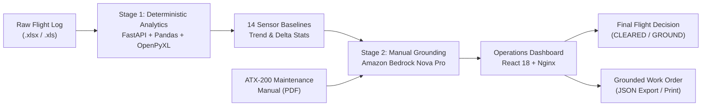

# ✈️ S.V.O.R.A — Aircraft Maintenance Intelligence Platform

[](https://fastapi.tiangolo.com)
[](https://reactjs.org/)
[](https://vitejs.dev/)
[](https://aws.amazon.com/bedrock/)
[](https://aws.amazon.com/eks/)
[](https://www.docker.com/)
[](https://github.com/features/actions)

> **S.V.O.R.A** (*Smart Vehicle Operational Reliability & Analytics*) is a production-grade, AI-assisted **Aircraft Maintenance Intelligence Platform**. It transforms raw aircraft flight telemetry logs into deterministic engineering baseline analytics and provides **aviation-manual-grounded maintenance decisions** powered by **Amazon Bedrock (Nova Pro)**.

---

## 📌 Live Cloud Deployments (AWS ap-southeast-2)

| Service | Component | Endpoint |
| :--- | :--- | :--- |
| 🖥️ **Frontend Dashboard** | React 18 + Nginx Web UI | [http://a25b44ceade0e423d85b39c3068536fd-1211494327.ap-southeast-2.elb.amazonaws.com/](http://a25b44ceade0e423d85b39c3068536fd-1211494327.ap-southeast-2.elb.amazonaws.com/) |
| ⚙️ **Backend REST API** | FastAPI Service Status | [http://a8a94145817e34fa1b1e8b4238d60b21-1786539109.ap-southeast-2.elb.amazonaws.com/](http://a8a94145817e34fa1b1e8b4238d60b21-1786539109.ap-southeast-2.elb.amazonaws.com/) |
| 📖 **Interactive Swagger UI** | OpenAPI Live Testing | [http://a8a94145817e34fa1b1e8b4238d60b21-1786539109.ap-southeast-2.elb.amazonaws.com/docs](http://a8a94145817e34fa1b1e8b4238d60b21-1786539109.ap-southeast-2.elb.amazonaws.com/docs) |

---

## 🚀 The Core Problem & Solution

Traditional aircraft maintenance systems often suffer from:
1. **Disconnected Telemetry**: Sensor data is reviewed in isolation without historical context or baseline trend metrics.
2. **Manual Cross-Referencing**: Engineers spend hours thumbing through complex Aircraft Maintenance Manuals (AMMs) to verify whether vibration or temperature spikes breach safety thresholds.
3. **AI Hallucination Risks**: General LLMs frequently hallucinate thresholds or invent imaginary part numbers and tolerances.

### The S.V.O.R.A Two-Stage Pipeline



1. **Stage 1 — Deterministic Engineering Analytics (`POST /aircraft/analytics`)**:
   - Ingests landed-flight Excel telemetry (`.xlsx`).
   - Normalizes and sanitizes sensor headers across 14 flight parameters.
   - Computes statistical baselines over the previous 10-flight window (mean, median, standard deviation, change percentage, trend direction).
   - Intentionally strips existing decision tags so downstream AI reasons purely from raw, unvarnished telemetry.

2. **Stage 2 — Manual-Grounded AI Diagnostics (`POST /aircraft/maintenance-prediction`)**:
   - Sends the computed Stage 1 analytics JSON along with the official **AeroTech ATX-200 Maintenance Manual PDF** directly to **Amazon Bedrock (Nova Pro)** using the multimodal Converse API.
   - Forces strict constraint rules: the AI can only cite thresholds and procedures verified in the manual.
   - Includes a deterministic fallback rule engine based on Chapters 3, 5, 7, 8, & 9 of the manual for zero-downtime resilience against AWS quota or network limits.

---

## 🌟 Key Features

- **✈️ Live Flight Intake & Monitoring**: Drag-and-drop Excel telemetry upload with animated SVG flight path tracking and departure-en route-landing phase monitoring.
- **📊 14 Sensor Health Diagnostics**: Visual gauges and real-time trend analytics covering:
  - Core Engine Temperature, Exhaust Gas Temperature (EGT), Oil Temperature & Pressure
  - Engine Vibration (RMS mm/s), Compressor Pressure, Fuel Flow, Engine RPM
  - Hydraulic System Pressure, Ambient & Outside Air Temperatures (OAT), Humidity
- **🛡️ Fly / No-Fly Decision Engine**: Clear operational readiness categorization:
  - `CLEARED_TO_FLY`
  - `FLY_WITH_MONITORING`
  - `MAINTENANCE_REQUIRED_BEFORE_FLIGHT`
  - `GROUND_AIRCRAFT`
- **📖 Verifiable Manual Grounding**: Exact citations for every threshold violation (e.g., Table 3.1, Chapter 6.5 Bearing Inspection, Chapter 5.1.4 Oil Leakage).
- **📋 Interactive Inspection Checklist**: Actionable step-by-step checklist with clickable verification for maintenance engineers on the ramp.
- **📝 Automated Work Order Generation**: Generates compliant maintenance work orders with task descriptions, parts/tools list, and one-click JSON export or print.

---

## 🛠️ Technology Stack

| Domain | Technologies |
| :--- | :--- |
| **Frontend** | React 18, Vite 5, JavaScript (ESModules), Modern Dark-Aviation UI, CSS3 Design System |
| **Backend** | Python 3.12, FastAPI 0.115, Uvicorn, Pandas, OpenPyXL, Boto3, UV package manager |
| **Generative AI** | Amazon Bedrock (`amazon.nova-pro-v1:0` via Converse API with PDF byte injection) |
| **Containerization** | Docker, Multi-Stage Builds, Lightweight Nginx Alpine (< 10MB RAM), Python 3.12-slim |
| **Cloud Infrastructure** | AWS Elastic Kubernetes Service (Amazon EKS), Amazon ECR, AWS Classic Load Balancers |
| **CI / CD Pipeline** | GitHub Actions (automated test, build, push to ECR, and zero-downtime EKS rollout) |

---

## 📁 Repository Structure

```text
S.V.O.R.A/
├── .github/
│   └── workflows/
│       └── deploy.yml                                # Automated CI/CD deployment to Amazon EKS
├── .gitignore                                        # Comprehensive git exclusion rules
├── README.md                                         # Project documentation (this file)
├── PROJECT_DETAILS.md                                # Deep technical architecture & specifications
├── purpose.md                                        # Original platform product specification
├── backend/
│   ├── app.py                                        # FastAPI application & REST endpoints
│   ├── dockerfile                                    # Production backend container (uv + python:3.12-slim)
│   ├── .dockerignore                                 # Backend Docker build exclusion rules
│   ├── docker-compose.yml                            # Standalone backend container definition
│   ├── pyproject.toml                                # Python project configuration
│   ├── requirements.txt                              # Pinned Python dependencies
│   ├── .env.example                                  # Backend environment variable template
│   ├── data/
│   │   ├── aircraft_maintenance_intelligence_dataset.xlsx # Bundled multi-aircraft sample telemetry
│   │   └── AeroTech_ATX200_Maintenance_Manual.pdf   # Official ATX-200 maintenance manual
│   └── src/
│       ├── __init__.py
│       └── aircraft_maintenance/
│           ├── __init__.py
│           ├── engineering_analytics.py              # Stage 1: Pandas deterministic baseline engine
│           └── bedrock_maintenance_analyzer.py       # Stage 2: Bedrock Converse API + ATX-200 rule engine
├── frontend/
│   ├── index.html                                    # Single Page Application HTML entry point
│   ├── package.json                                  # NPM dependencies and scripts
│   ├── vite.config.js                                # Vite configuration
│   ├── dockerfile                                    # Multi-stage production container (Node + Nginx)
│   ├── .dockerignore                                 # Frontend Docker build exclusion rules
│   ├── .env.example                                  # Frontend environment variable template
│   └── src/
│       ├── main.jsx                                  # React entry point
│       ├── App.jsx                                   # Core dashboard application & layout
│       ├── styles.css                                # Design system & responsive styles
│       ├── api/
│       │   └── client.js                             # API communication client
│       └── components/
│           └── PanelCard.jsx                         # Reusable card container component
└── kubernetes/
    ├── backend-deployment.yaml                       # Backend EKS deployment specification
    ├── backend-service.yaml                          # Backend AWS LoadBalancer service
    ├── frontend-deployment.yaml                      # Frontend EKS deployment specification
    ├── frontend-service.yaml                         # Frontend AWS LoadBalancer service
    └── aws-secrets.yml                               # Template for Kubernetes secrets
```

---

## 💻 Running the Platform Locally

### Prerequisites
- **Python 3.12+** and [uv](https://docs.astral.sh/uv/) (or standard pip)
- **Node.js 20+** and `npm`

### 1. Start the Backend API
```powershell
cd backend

# Option A: With uv (recommended)
uv run uvicorn app:app --host 0.0.0.0 --port 8000 --reload

# Option B: Standard Python
pip install -r requirements.txt
python -m uvicorn app:app --host 0.0.0.0 --port 8000 --reload
```
The backend starts at `http://localhost:8000`. You can explore the interactive API docs at `http://localhost:8000/docs`.

### 2. Start the Frontend Application
```powershell
cd frontend
npm install
npm run dev
```
Open **`http://localhost:3000`** in your browser.

---

## 🐳 Running with Docker

### Backend Container
```powershell
cd backend
docker build -t svora-backend .
docker run -p 8000:8000 svora-backend
```

### Frontend Container
```powershell
cd frontend
docker build -t svora-frontend .
docker run -p 80:80 svora-frontend
```

---

## ☸️ Cloud Deployment Architecture (Amazon EKS)

The application runs on an **Amazon EKS (Elastic Kubernetes Service)** cluster with worker nodes on EC2 in `ap-southeast-2` (Sydney).

```
                        [ Internet User ]
                                │
        ┌───────────────────────┴───────────────────────┐
        ▼                                               ▼
[ Frontend ELB (Port 80) ]                     [ Backend ELB (Port 80) ]
        │                                               │
        ▼                                               ▼
[ frontend-maintenance Pod ]                  [ backend-api-maintenance Pod ]
  - Nginx Alpine                                - FastAPI + Uvicorn
  - Port 80                                     - Port 8000
                                                        │
                                                        ▼
                                              [ Amazon Bedrock ]
                                                - Nova Pro (us-east-1)
                                                - ATX-200 PDF Grounding
```

### Deploying to Kubernetes
```powershell
# 1. Apply credentials secret
kubectl apply -f kubernetes/aws-secrets.yml

# 2. Deploy backend and service
kubectl apply -f kubernetes/backend-deployment.yaml
kubectl apply -f kubernetes/backend-service.yaml

# 3. Deploy frontend and service
kubectl apply -f kubernetes/frontend-deployment.yaml
kubectl apply -f kubernetes/frontend-service.yaml

# 4. Check status
kubectl get pods
kubectl get svc
```

---

## 🔄 Automated CI/CD (GitHub Actions)

The repository includes a production workflow in [`.github/workflows/deploy.yml`](.github/workflows/deploy.yml) that triggers on every push to `main`:
1. **ECR Authentication**: Logs in to Amazon Elastic Container Registry (`644272928959.dkr.ecr.ap-southeast-2.amazonaws.com`).
2. **Multi-Container Build & Push**: Builds both backend and frontend images and pushes them with unique commit digests and `latest` tags.
3. **API URL Injection**: Automatically injects the live Backend Load Balancer URL into the frontend build.
4. **EKS Rollout**: Updates Kubernetes manifests, updates the `aws-credentials` secret, and triggers a zero-downtime rolling restart on EKS.

---

## 📄 License & Attribution

Developed for AI-assisted aircraft operational engineering and predictive maintenance.  
Grounding manual: *AeroTech Aviation Systems ATX-200 Turbofan Engine Maintenance & Inspection Manual*.
